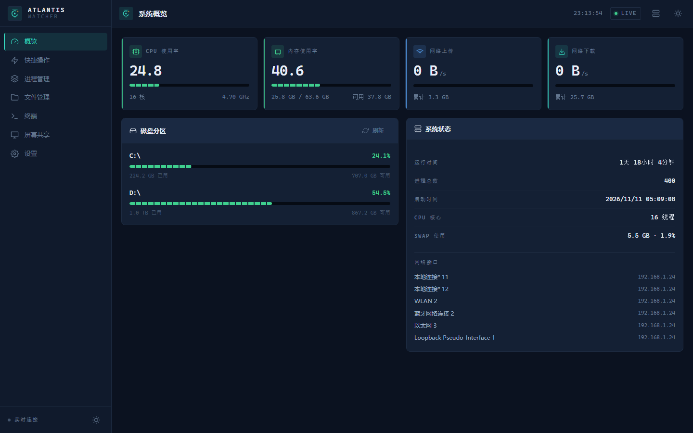
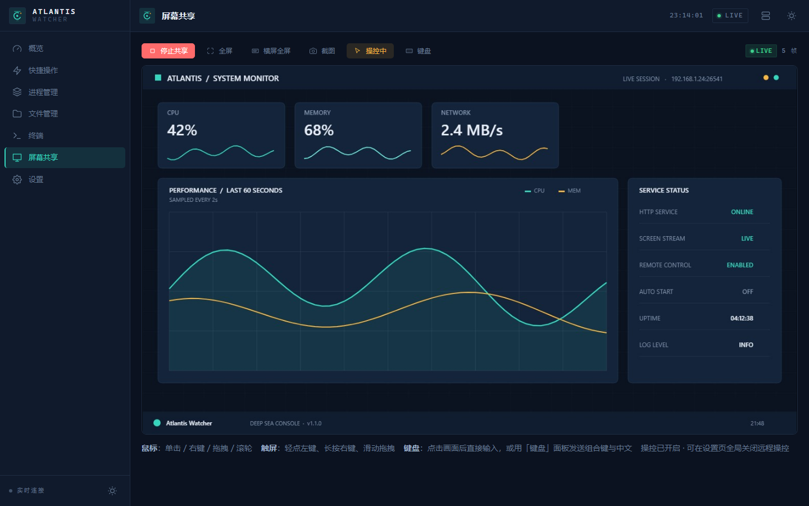
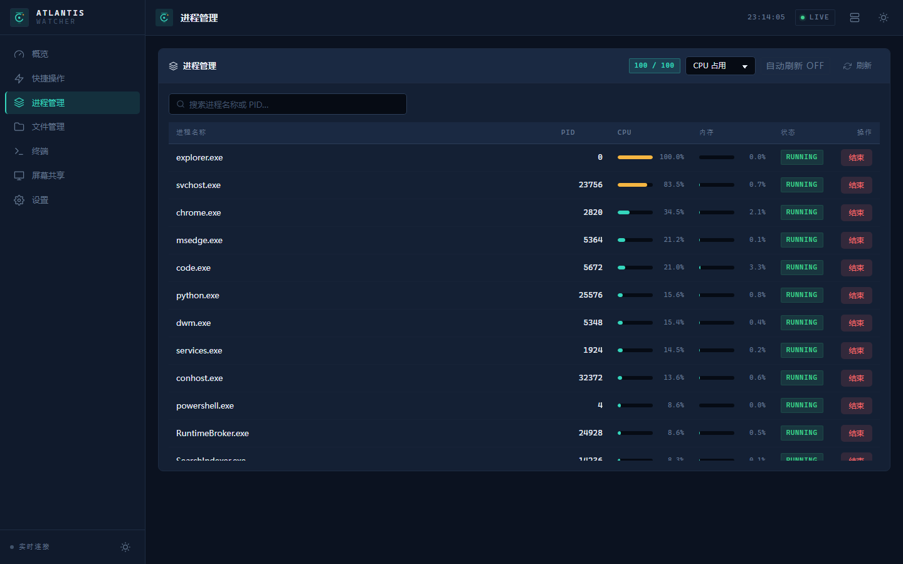
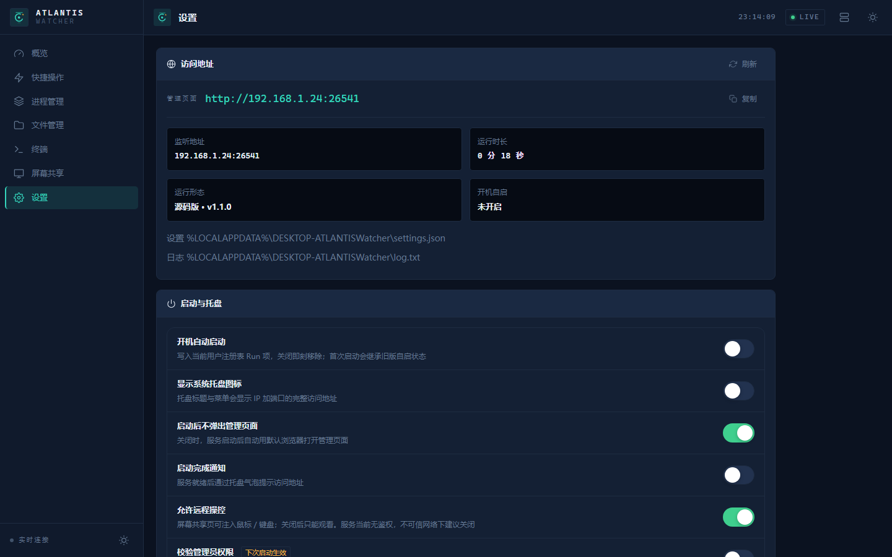
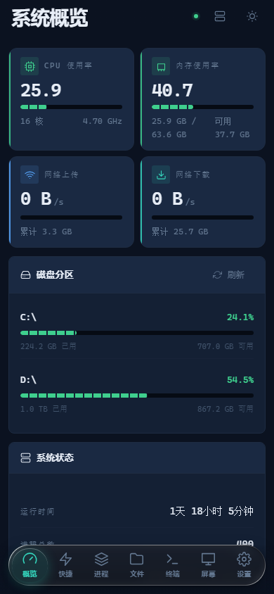
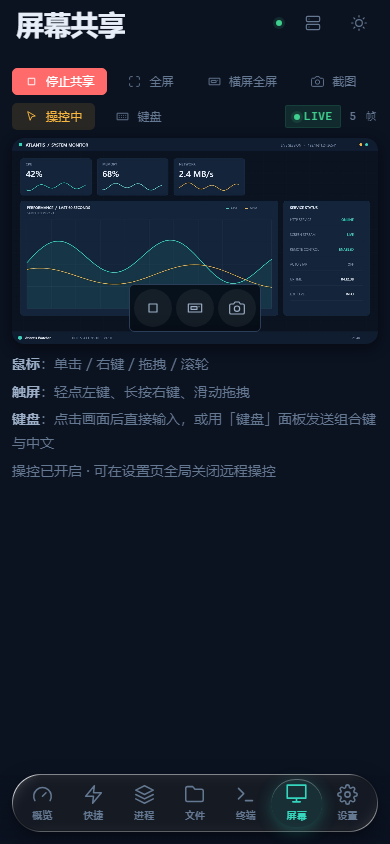
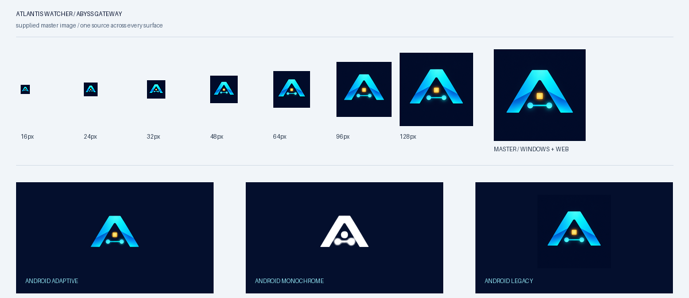

<div align="center">
  
  <h1>Atlantis Watcher</h1>
  <p><strong>深海仪表盘风格的 Windows 远程控制与系统监控工具</strong></p>
  <p>v1.1.0 &nbsp;·&nbsp; Windows 10 / 11 &nbsp;·&nbsp; 局域网 Web + Android APK</p>
</div>

---

在 Windows 主机上跑一个服务，同一局域网内的浏览器或手机即可查看系统状态、管理进程与文件、执行命令、共享屏幕并**直接远程操控**。后端 FastAPI，前端 Vue 3，桌面端 PyInstaller + Inno Setup 出 exe 与安装向导，移动端 Capacitor 出 APK。

> ⚠️ **本项目没有鉴权**。任何能连到 `26541` 的人都能执行命令、读写文件、看屏幕并注入鼠标键盘。请只在可信局域网使用，**不要暴露到公网** —— 见第 13 节「安全须知」。

---

## 1. 功能一览

| 模块 | 能力 | 入口 |
|---|---|---|
| 系统概览 | CPU / 内存 / 网络 / 磁盘分区 / 系统状态 / 网卡地址实时刷新 | `/#/overview` |
| 系统监控 | 2 秒一次的 WebSocket 指标流与趋势图 | `/#/monitor` |
| 进程管理 | 进程列表、搜索、按 CPU / 内存排序、5s 自动刷新、结束 / 强制结束 | `/#/processes` |
| 文件管理 | 驱动器浏览、上传下载、新建、重命名、复制移动、删除、文本编辑、图标预览、执行 | `/#/files` |
| 终端 | CMD / PowerShell 命令执行、危险命令黑名单 | `/#/terminal` |
| 屏幕共享 | JPEG 推流、鼠标 / 滚轮 / 键盘 / 触摸注入、组合键与中文输入、**横屏全屏影院模式** | `/#/screen` |
| 快捷操作 | 关机 / 定时关机 / 取消 / 重启 / 锁屏 / 注销 / 关闭与点亮显示器 | `/#/power` |
| 设置 | 开机自启、托盘、监听地址与端口、日志级别、帧率与画质、远程操控总开关、重启服务 | `/#/settings` |
| 系统托盘 | 标题与菜单显示 `IP:端口`，打开管理页 / 设置页、复制地址、开关自启、重启服务、查看日志、退出 | 托盘右键 |
| Android APK | 局域网主机自动嗅探、Liquid Glass 底部导航、横屏全屏 | APK |

---

## 2. 界面一览

<table>
  <tr>
    <td width="50%"><br><sub><b>系统概览</b> · 实时指标、磁盘分区与系统状态</sub></td>
    <td width="50%"><br><sub><b>屏幕共享 + 远程操控</b> · 工具栏含横屏全屏、虚拟键盘、操控开关</sub></td>
  </tr>
  <tr>
    <td width="50%"><br><sub><b>进程管理</b> · 搜索、排序、自动刷新、结束进程</sub></td>
    <td width="50%"><br><sub><b>设置</b> · 访问地址、开机自启、远程操控、服务与性能</sub></td>
  </tr>
</table>

**移动端**（iOS 26 Liquid Glass 底部导航）

<table>
  <tr>
    <td width="50%"><br><sub><b>移动端概览</b></sub></td>
    <td width="50%"><br><sub><b>移动端屏幕共享</b></sub></td>
  </tr>
</table>

**品牌标识「深渊网关」**：几何 A 形网关、中心控制信号块与双节点连接线，表达实时遥控、系统智能与局域网连接，16px 仍保持可读。

<p align="center"></p>

> 截图来自隔离演示环境：IP / 主机名 / 端口 / 本机路径 / 进程名均已示例化，屏幕共享画面是 Canvas 生成的**示例桌面**而非真实屏幕。重生成方式见 7.4 节「截图与可视化回归」。

---

## 3. 快速开始（用现成产物）

发布产物统一在 `dist/`，`SHA256SUMS.txt` 提供 4 项校验值。

| 文件 | 体积 | 用途 |
|---|---|---|
| `AtlantisWatcher-Setup-1.1.0.exe` | 54.9 MB | **安装向导**：安装位置、桌面快捷方式、卸载入口、可选注册表自启 |
| `AtlantisWatcher-1.1.0-portable.zip` | 76.0 MB | onedir 便携包，解压即用（195 个文件，误报率最低） |
| `AtlantisWatcher-1.1.0-onefile.exe` | 75.9 MB | 单文件便携版，拷贝方便 |
| `AtlantisWatcher-1.1.0.apk` | 4.4 MB | Android debug 签名包 |

**Windows**：运行安装包（会请求管理员权限，关机 / 重启 / 锁屏需要），或解压便携 ZIP 后双击 `AtlantisWatcher.exe`。启动后托盘会显示 `IP:端口`，浏览器打开 `http://<本机IP>:26541` 即可；本机也可直接访问 `http://127.0.0.1:26541`。防火墙需放行 `26541`。

**Android**：安装 APK 后自动嗅探局域网中开着 `26541` 的主机并连接；8 秒超时才需要手动填写地址（如 `192.168.1.24:26541`）。

> 校验：`Get-FileHash dist\AtlantisWatcher-1.1.0.apk -Algorithm SHA256`，与 `dist\SHA256SUMS.txt` 比对。

---

## 4. 技术选型

| 层 | 选择 | 理由与取舍 |
|---|---|---|
| 后端 | FastAPI + Uvicorn | 原生 async、自动生成 OpenAPI、REST 与 WebSocket 同进程；比 Flask 少拼插件，比 Django 轻。代价是无内置鉴权，需自行加。 |
| 前端 | Vue 3 + Vite + Pinia + Vue Router（**hash 模式**） | 构建产物由后端静态托管；hash 路由不依赖服务端 rewrite，exe 与 APK WebView 两种宿主都能直接跑。 |
| 玻璃材质 | `glassy-liquid` | iOS 26 Liquid Glass 的 SVG 真折射 / WebGL 降级；`liquid-dom` 实测 WebGPU adapter 为 null 且命令式场景图与 Vue 冲突，未采用。 |
| 输入注入 | `pyautogui` + Win32 `SendMessageTimeoutW` | 截屏与输入复用同一依赖；关闭 / 点亮显示器走 `SC_MONITORPOWER`，无需额外服务。 |
| 桌面打包 | PyInstaller 6（spec 文件） | spec 可版本管理、支持 onedir / onefile 双模式与 manifest；**onedir** 启动快、误报低，**onefile** 便于单文件分发。 |
| 安装包 | Inno Setup 7 | 向导、快捷方式、卸载入口、升级覆盖、HKCU Run 自启，纯文本脚本可 review。 |
| Android | Capacitor 7 | 前端资源离线打包进 WebView，改前端不必重写原生；代价是受 WebView 能力边界约束（横屏锁定需真机实测）。 |
| 设置持久化 | JSON + 原子写 + Pydantic 校验 | 无数据库依赖，落 `%LOCALAPPDATA%`，避免往安装目录写文件触发 UAC。 |

---

## 5. 架构与运行期

```
main.py                     极简入口，import 期零副作用
  └─ app/bootstrap.py       编排：日志 → 设置 → UAC → 自启对齐 → 建应用 → 起服务 → 托盘
       ├─ app/factory.py    create_app(context)：路由 / CORS / 全局异常映射
       ├─ app/runtime.py    AppContext：Uvicorn、托盘、设置、关停事件的唯一持有者
       ├─ app/server.py     Uvicorn Config + 后台线程
       └─ app/tray_icon.py  pystray；标题 IP:端口，菜单动作直连 AppContext
```

- **无模块级 FastAPI 实例**：应用工厂由 bootstrap 调一次，避免 PyInstaller 冻结态重复 import / 重复注册路由。
- **设置热更新**：日志级别、屏幕共享 FPS / 画质即时生效；`host` / `port` 通过「立即重启服务」真实重启 Uvicorn。
- **优雅停机**：`server.should_exit = True` + join，不再 `os._exit(0)`；托盘「退出」与「重启服务」都是真实动作。
- **阻塞隔离**：命令执行、截屏编码、Win32 调用走 `asyncio.to_thread`；`cv2` / `numpy` / `pyautogui` 延迟导入，缩短冷启动。
- **路径**：资源由 `app/paths.py` 按 `sys._MEIPASS` / 项目根定位；日志与设置固定落 `%LOCALAPPDATA%\AtlantisWatcher\`，不依赖 `os.chdir()`。

---

## 6. 目录结构

```
atlantis_watcher/
├── main.py                      # 极简入口（无 import 期副作用）
├── AtlantisWatcher.spec         # PyInstaller 规格：资源 / hiddenimports / manifest / 双模式
├── installer.iss                # Inno Setup 7 安装向导脚本
├── icon.ico                     # Windows 多尺寸图标（16–256，逐尺寸 LOD）
├── app/
│   ├── bootstrap.py             # 启动 / 停机编排
│   ├── factory.py               # FastAPI 应用工厂 + 全局异常映射
│   ├── runtime.py               # AppContext
│   ├── server.py                # Uvicorn 封装
│   ├── config.py                # 运行期配置（单一实例）
│   ├── settings_store.py        # 用户偏好持久化（原子写 + 校验）
│   ├── paths.py                 # 资源与用户数据路径
│   ├── logging_utils.py         # 幂等日志初始化
│   ├── models.py / exceptions.py / decorators.py / utils.py
│   ├── api_commands.py          # 命令与电源操作路由
│   ├── tray_icon.py             # 系统托盘
│   ├── platform/windows.py      # UAC、注册表自启、网络地址、剪贴板
│   ├── routers/                 # meta / system / files / settings / websocket / control
│   └── services/                # command / file / system / input
├── frontend/
│   ├── src/{api,components,composables,router,stores,styles,utils,views}/
│   ├── public/                  # favicon / apple-touch-icon / PWA 图标
│   ├── android/                 # Capacitor 原生工程（含品牌 mipmap / splash）
│   ├── capture-screenshots.mjs  # README 截图生成（示例画面 + 脱敏）
│   ├── verify*.mjs              # Playwright 可视化 / 交互 / 品牌回归
│   ├── capacitor.config.json
│   └── vite.config.js           # 产物 → ../static/dist
├── static/dist/                 # Vite 构建产物，后端托管并打进 exe / APK
├── assets/
│   ├── brand/                   # SVG 真源 + 品牌总览图
│   └── screenshots/             # README 界面截图
├── tools/
│   ├── brand_assets.py          # ★ 品牌图标单一真源（全端资产生成）
│   ├── build_android.py / configure_android.py
│   ├── verify_package.py / sign.py / runtime_hook.py
│   └── make_icon.py / make_android_icon.py   # 兼容入口
├── build.py / build_release.py  # 构建流水线（根目录）
├── dist/                        # 发布产物（不入库）
├── requirements.txt / pyproject.toml
├── README.md
└── BUILD_README.md              # 构建与打包深度指南
```

---

## 7. 开发运行

### 7.1 首次搭建

```bash
# 后端依赖（Python 3.13）
pip install -r requirements.txt

# 前端依赖 + 构建产物
cd frontend && npm install && npm run build && cd ..
```

### 7.2 两种启动方式

```bash
# 生产式：后端直接托管 static/dist
python main.py --no-elevation          # --no-elevation 仅用于本地调试，跳过 UAC
start http://127.0.0.1:26541

# 开发式：两个终端
python main.py --no-elevation          # 终端 A，:26541
cd frontend && npm run dev             # 终端 B，:5173（/api 与 /ws 自动代理到 26541）
```

> 正常运行不加 `--no-elevation`；exe 带 `requireAdministrator` manifest，会弹 UAC。

### 7.3 常用命令

| 命令 | 作用 |
|---|---|
| `npm --prefix frontend run lint` | ESLint（要求零警告） |
| `npm --prefix frontend run build` | 构建并同步 `static/dist`（**改前端后必做**） |
| `python -m compileall -q app` | 后端语法检查 |
| `python tools/verify_package.py` | 打包产物真实启动验收 |
| `python tools/brand_assets.py` | 全量重生成品牌资产 + 预览图 |
| `AW_BASE_URL=http://127.0.0.1:26541 node frontend/verify-control.mjs` | 屏幕 / 进程 / 设置三页回归 |
| `AW_BASE_URL=... node frontend/verify-settings.mjs` | 设置页回归 |
| `AW_BASE_URL=... node frontend/verify-brand.mjs` | 品牌标记与根级 favicon 回归 |

### 7.4 截图与可视化回归

`frontend/capture-screenshots.mjs` 生成第 2 节的 6 张图，需后端已运行：

```bash
AW_BASE_URL=http://127.0.0.1:26541 node frontend/capture-screenshots.mjs
```

脚本会拦截 `/ws/screen` 注入 Canvas 绘制的示例桌面帧（**不截真实屏幕**），并把 IP、临时端口、主机名、用户名、本机路径与进程名示例化。回归脚本统一支持 `AW_BASE_URL`，因此可在临时端口跑，不必停掉正在运行的服务。

---

## 8. 打包便携版

```bash
# 前置：前端必须先构建，否则 exe 内页面白屏（spec 有前置校验会直接中止）
npm --prefix frontend run lint && npm --prefix frontend run build

# onedir（正式分发，启动快、误报低）
AW_ONEFILE=0 python -m PyInstaller AtlantisWatcher.spec --noconfirm --distpath dist --workpath build

# onefile（单文件便携）
AW_ONEFILE=1 python -m PyInstaller AtlantisWatcher.spec --noconfirm --distpath dist --workpath build
```

**资源嵌入**：spec 的 `datas` 只收集 `static/dist/` 与 `icon.ico`。Vite 产物里的 `favicon.svg` / `favicon.ico` / `apple-touch-icon.png` / `icon-192.png` / `icon-512.png` 会自动随之进入 `_internal/static/dist/`，无需另配；运行时由 `app/paths.py` 从 `sys._MEIPASS` 定位，根级图标由 `app/routers/meta.py` 白名单路由提供。

| 常见坑 | 处理 |
|---|---|
| exe 打开白屏 | 前端没 `npm run build`；检查 `static/dist/index.html` 是否存在 |
| `--onefile` 对 spec 无效 | PyInstaller 6 不允许对 spec 传该参数，用环境变量 `AW_ONEFILE` 切换 |
| 日志 / 设置写不进去 | 冻结态不能写 `_MEIPASS`；已由 `runtime_hook.py` + `paths.py` 落到 `%LOCALAPPDATA%` |
| 图标不显示 | 确认 `icon.ico` 是标准多帧 ICO（不是 PNG 改名）；`python tools/brand_assets.py --windows` |
| 高 DPI 发虚 / 长路径报错 | manifest 已声明 `PerMonitorV2` / `longPathAware` / UTF-8 codepage |

> 也可用 `python build.py` / `python build.py --onefile` 走构建流水线；若环境启用了批量删除保护导致清理旧 `dist` 失败，改用上面的直接 PyInstaller 命令。

---

## 9. 制作安装包

```bash
"%LOCALAPPDATA%\Programs\Inno Setup 7\ISCC.exe" installer.iss
```

产物：`dist\AtlantisWatcher-Setup-1.1.0.exe`。

| 项 | 配置 |
|---|---|
| 向导 | `WizardStyle=modern`、中文、`MinVersion=10.0`、x64 |
| 安装目录 | `{autopf}\AtlantisWatcher`，可选安装位置 |
| 快捷方式 | 开始菜单 + 可选桌面，图标取 exe 内嵌资源 |
| 卸载 | 标准卸载入口，可选清理 `%LOCALAPPDATA%\AtlantisWatcher` 日志与数据 |
| 开机自启 | 可选任务写 HKCU `...\Run\AtlantisWatcher`，与应用内设置页同源、可随时关闭 |
| 图标 | `SetupIconFile=icon.ico` |
| 升级 | `CloseApplications=yes`，覆盖安装保留用户数据 |

**代码签名**：未配置签名时**不要**声明 `SignTool=`（Inno Setup 7 会直接报编译错误）。正式分发用 `tools/sign.py --pfx cert.pfx` 签名 exe，再在 `installer.iss` 里配置 `SignTool`。

---

## 10. Android APK

```bash
python tools/build_android.py                 # 全量（含前端构建）
python tools/build_android.py --skip-frontend # 前端已构建时，约 12s
python tools/build_android.py --install       # 打包后 adb 安装到已连接设备
```

产物：`frontend/android/app/build/outputs/apk/debug/app-debug.apk`（约 4.4 MB）。

| 组件 | 要求 |
|---|---|
| JDK | **21**（Capacitor 7 / AGP 8.x 要求；本机 `D:\AndroidToolchain\jdk-21.0.13+9`） |
| Android SDK | Platform 35+ / Build-Tools 34+，含 `platform-tools`（本机 `D:\AndroidToolchain\android-sdk`） |
| Node | 18+ |
| Gradle | wrapper 自动下载（已配置腾讯云镜像） |

**架构**：APK 内是离线前端资源，WebView 通过 HTTP / WS 连局域网主机，不直连数据库。

```
APK (WebView)  ──HTTP / WS──►  192.168.x.x:26541  (运行 Atlantis Watcher 的电脑)
```

- `/health` 是嗅探契约：并发探测常见 `/24` 网段，校验 `service === "Atlantis Watcher"`，单请求 600ms、总超时 8s。
- 浏览器同源访问时不显示嗅探引导；APK 直接使用持久化主机地址，HTTP 与 WebSocket 共用。
- 屏幕共享的影院模式优先 `screen.orientation.lock('landscape')`；老 WebView 不支持时用 CSS 90° 旋转降级，并在坐标换算里做逆变换保证点击不偏移。

正式签名：`keytool -genkey -v -keystore atlantis.keystore -alias atlantis -keyalg RSA -keysize 2048 -validity 10000`，在 `frontend/android/keystore.properties`（已 gitignore）配置 `storeFile / storePassword / keyAlias / keyPassword`，再用 `--release` 构建。

---

## 11. 设置与开机自启动

打开侧栏或底部导航的「设置」页：

| 分组 | 项目 | 生效方式 |
|---|---|---|
| 访问地址 | 当前 `IP:端口`、运行时长、自启状态、复制地址 | 只读展示，可刷新 |
| 启动与托盘 | 开机自启动、显示托盘、启动后不弹管理页、启动完成通知、校验管理员权限 | 自启即时；权限项下次启动生效 |
| 服务与性能 | 监听地址、端口、日志级别、屏幕共享帧率、画质 | 地址 / 端口需点「立即重启服务」；其余即时 |
| 安全 | 允许远程操控（全局开关） | 即时，关闭后 `/api/control` 返回 403、`/ws/control` 拒绝连接 |

- 偏好保存在 `%LOCALAPPDATA%\AtlantisWatcher\settings.json`（`os.replace` 原子写 + Pydantic 校验），日志同目录。
- 自启使用 HKCU `Software\Microsoft\Windows\CurrentVersion\Run\AtlantisWatcher`，可在设置页随时开关；旧版写进「启动」文件夹的 `.lnk` 会被自动迁移清理，避免双重启动。首次运行继承已有自启状态，**全新安装默认不自启**。
- 托盘标题与菜单直接显示 `IP:端口`，网络变化 30 秒内自动刷新。

---

## 12. API 一览

| 方法 | 路径 | 说明 |
|---|---|---|
| GET | `/health` | 健康检查（APK 局域网嗅探的命中契约，保持轻量） |
| GET | `/api/runtime` | 运行时信息（地址列表、运行时长、自启状态、文件路径） |
| GET / PUT | `/api/settings` | 读取 / 局部更新用户设置 |
| POST | `/api/settings/restart` | 重启 HTTP 服务 |
| GET | `/api/system/info` · `/api/system/processes` | 系统信息快照 / 进程列表 |
| POST | `/api/system/kill-process` | 终止进程 |
| POST | `/api/cmd` | 执行 CMD / PowerShell 命令 |
| POST | `/api/shutdown` · `/api/shutdown/{seconds}` | 关机 / 定时关机 |
| POST | `/api/cancel` · `/api/reboot` · `/api/lock` · `/api/logout` | 取消关机 / 重启 / 锁屏 / 注销 |
| POST | `/api/monitor/off` · `/api/monitor/on` | 关闭 / 点亮显示器 |
| GET | `/api/files/drives` · `/api/files/list` · `/api/files/content` · `/api/files/icon` | 驱动器 / 目录 / 文本内容 / 文件图标 |
| POST | `/api/files/content` · `/api/files/mkdir` · `/api/files/create` · `/api/files/operation` · `/api/files/execute` | 保存 / 新建目录 / 新建文件 / 重命名删除复制移动 / 执行 |
| GET | `/api/files/download` · POST `/api/files/upload` | 下载 / 上传 |
| GET | `/api/control/status` | 远程操控开关与主机屏幕尺寸 |
| POST | `/api/control` | 注入单条输入事件（WS 不可用时的 REST 兜底） |
| WS | `/ws/monitor` | 实时监控流（文本 JSON，2s 一帧） |
| WS | `/ws/screen` | 屏幕共享流（**二进制 JPEG 帧**） |
| WS | `/ws/control` | 远程操控主通道（归一化坐标事件流） |

根级 `/favicon.svg`、`/favicon.ico`、`/apple-touch-icon.png` 等由 `app/routers/meta.py` 白名单路由提供，不进 OpenAPI schema。完整交互文档见 `/docs`（FastAPI 自动生成）。

---

## 13. 安全须知

**当前全站零鉴权**：29 条端点没有 `Depends` / `Security` / Origin 校验，CORS 为 `allow_origins=["*"]`，且接口本身不需要凭据。风险来自暴露面，不是恶意载荷。

| 暴露面 | 后果 |
|---|---|
| `/api/cmd` | 任意命令执行（`cmd /c chcp 65001 & <输入>`，`&` 可分隔命令；黑名单仅做子串匹配） |
| `/api/files/*` | 任意绝对路径读 / 写 / 删除 / 执行，上传 `filename` 未做 basename |
| `/ws/screen` | 任意网页可读屏幕帧（无 Origin 校验） |
| `/ws/control` · `/api/control` | 鼠标 / 键盘注入，等于把桌面交出去 |
| `/api/settings` | 改端口、关托盘、开自启 |

**上线前必须做的**：

1. 只在可信局域网使用，防火墙入站规则**只放行信任 IP**；绝不做端口映射到公网。
2. 不用远程操控时，在设置页关掉「允许远程操控」。
3. 只需本机访问时把「监听地址」改为 `127.0.0.1`（注意：APK 嗅探依赖局域网可达，改后手机连不上）。
4. `require_admin` 默认开启会放大风险，非必要时关掉。
5. 若要暴露到更大范围，先补 P0：全局 Bearer Token / 一次性配对码、CORS 显式白名单、WS 的 Origin + 首帧 token 校验、文件接口根目录沙箱、命令白名单与超时上限。

---

## 14. 测试与排错

### 14.1 本版验收记录

| 项目 | 结果 |
|---|---|
| onedir / onefile 真实启动（隔离端口 26543 / 26544、隔离 `%LOCALAPPDATA%`） | **26 / 26 通过** |
| OpenAPI 端点 /health / 静态资源 / 日志落盘 | 29 条端点齐全，全部 200 |
| 远程操控开关、控制事件校验 | 开关可读；缺坐标 / 非法类型 422，禁用后 403（**零真实鼠标键盘注入**） |
| exe 内前端与图标 | `_internal/static/dist/` 6 个资源与源码逐文件 SHA256 一致 |
| APK 内前端与图标 | `assets/public/` 与 `static/dist/` 逐文件一致，41 个图标 / splash 资源 |
| 前端 | `lint` 零警告、`build` 通过 |
| 可视化 | 桌面 + 移动 × 三页 `CONTROL_UI_OK`、品牌 `BRAND_UI_OK`、截图 `CAPTURE_OK` |

### 14.2 Windows Defender / SmartScreen 误报

> ⚠️ **未签名的 exe，尤其包含 `pyautogui` 输入注入与屏幕截屏，经常被 Windows Defender SmartScreen 或企业 EDR 判为风险。** 这不是代码缺陷。

- 规避：正式分发前做**代码签名**（`tools/sign.py --pfx cert.pfx`），或让用户把安装目录加入白名单。
- **onedir 误报率明显低于 onefile**；spec 已关闭 UPX（加壳会显著抬高误报）。
- 不要通过反复重打包去「碰运气」，签名与白名单才是正解。

### 14.3 常见问题

| 现象 | 原因 / 处理 |
|---|---|
| exe 页面白屏 | 前端未 `npm run build`；或 `static/dist` 未打进包 |
| 端口 26541 被占 | 旧进程还在跑；设置页改端口，或先停旧服务 |
| 非管理员环境无法调试 | `__COMPAT_LAYER=RunAsInvoker` + `python main.py --no-elevation` + 隔离 `LOCALAPPDATA` |
| 后端启动后很快无响应 | stdout 接 `PIPE` 但无人读取，访问日志写满管道会阻塞 Uvicorn —— **日志必须落文件** |
| 屏幕共享全黑 | `/ws/screen` 是二进制 JPEG，前端必须 `binaryType='arraybuffer'`，按 JSON 解析会白屏 |
| 命令输出读不到 | 后端 `BaseResponse` 的输出在 `data.output`，不在顶层 |
| 托盘不显示 / 图标糊 | 设置页 `show_tray`；托盘显式取 ICO 的 48px 帧，16px 用逐尺寸 LOD |
| 网页标签没有图标 | 根级图标由 `app/routers/meta.py` 白名单路由提供，后端只挂 `/static` 与 `/assets` |
| APK 卡在启动画面 | Vite `base` 必须是 `./`（相对路径），且后端要挂 `/assets` |
| 改了前端没生效 | 必须 `npm run build` 把产物同步到 `static/dist` |

### 14.4 需要在目标机器实测

- Android 13+ **单色主题图标**与自适应前景在各厂商启动器上的裁切效果；`screen.orientation.lock('landscape')` 在目标机型 WebView 的支持情况（不支持会自动降级到 CSS 旋转）。
- 16px 托盘图标在不同 DPI / 主题下的清晰度。
- Inno Setup 以 admin 模式安装时写 HKCU 自启项：同账户 UAC 提权没问题，跨账户提权可能写到管理员账户，**最稳妥是装好后用应用内设置页开启自启**。

---

## 15. 开发者约定

1. **改前端必须 `npm run build`**，`static/dist` 是后端与所有发布包的前端唯一来源。
2. **打包 exe / APK 前必须先构建前端**；发布打包是显式动作，不在代码更新时自动执行。
3. **品牌图标只有一个真源**：`tools/brand_assets.py`。禁止在前端或脚本里另画图形；改完需 `npm run build` 同步。
4. 命令与截屏等同步阻塞操作一律走 `asyncio.to_thread`，不要阻塞 event loop。
5. `/health` 保持轻量，不枚举注册表 / 网卡，维持 APK 嗅探契约。

构建与打包的深度说明见 **[BUILD_README.md](BUILD_README.md)**。
